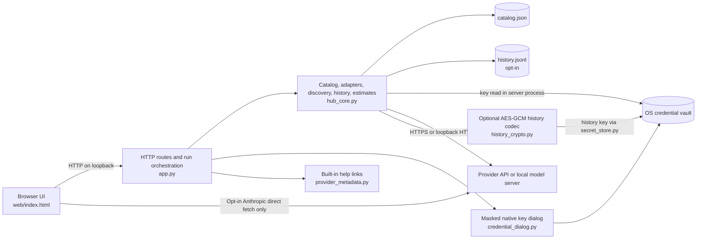

# Architecture

Poly-LLM Hub is a local Python server with a browser UI. The server binds to `127.0.0.1:8765`; Local Proxy provider requests go from that process to the configured provider or local inference endpoint. The opt-in Anthropic Direct Connection is the sole exception: its Chat and discovery requests go from the browser straight to Anthropic.

## Request flow

1. The browser loads the static page from `app.py` and reads the public catalog. It stores selected model-entry IDs in `localStorage`. In Local Proxy mode, prompts, answers, and credentials are not written there. Direct Anthropic mode stores only its explicit user-provided key in browser `localStorage` and sends prompt calls directly to Anthropic.
2. A comparison request includes the prompt, selected model-entry IDs, and run settings. The server validates the request, loads the current catalog, resolves model entries to connections, and starts a bounded comparison run.
3. `hub_core.py` maps the request to the configured protocol. The server reads a saved OS-vault key when available, otherwise uses the configured environment-variable fallback, and sends the prompt directly to the selected destination.
4. The browser polls the in-memory run record. With streaming enabled, text deltas are added to that record as they arrive.
5. If the user enabled history, completed model results are appended to `history.jsonl`, optionally encrypted with AES-GCM using a key stored in the same OS vault. Summaries and user ratings are derived from decrypted rows and append-only rating/preference events. Exports are always readable.

## Persistence and security boundaries

- The catalog lives under `%APPDATA%\\Poly-LLM-Hub` on Windows and `~/.local/share/Poly-LLM-Hub` when `APPDATA` is absent. It stores provider configuration, model metadata, and prompt sets explicitly saved by the user.
- History is separate, local, and off by default. It may contain prompts and complete model responses. Optional AES-GCM encryption uses a random OS-vault key; the user can export or clear decrypted history.
- Local Proxy credentials are stored by `secret_store.py` in Windows Credential Manager, Linux Secret Service (`secret-tool`), or macOS Keychain. The browser only passes a connection ID to open the native masked dialog. Direct Anthropic credentials stay in browser storage and never enter a Python request body.
- `app.py` accepts browser requests on loopback and protects mutations with Host and Origin checks. These checks do not authenticate other processes running as the same user.
- Remote provider calls use HTTPS; HTTP is allowed for loopback services. Redirects are restricted to the configured origin.

## Key modules

| Module | Responsibility |
| --- | --- |
| `app.py` | Local HTTP routes, request validation, run lifecycle, concurrency limits, retry/cancel behavior, history endpoints, and native credential-dialog launch. |
| `hub_core.py` | Catalog normalization and storage, provider request/response adapters, model discovery, usage/cost estimates, JSONL history, and empirical summaries. |
| `history_crypto.py` | Optional AES-GCM history records using an OS-vault key managed through `secret_store.py`. |
| `secret_store.py` | OS-specific credential read/write/delete operations. |
| `credential_dialog.py` | Native masked key-entry UI. |
| `provider_metadata.py` | Trusted key-creation and documentation links for built-in connections. |
| `web/index.html` | Browser UI, run polling/rendering, catalog forms, and local history views. |

The current design does not launch coding-agent CLIs, host a provider proxy, or provide a multi-user service. See [SECURITY_REVIEW.md](SECURITY_REVIEW.md) for limitations and [ADDING_PROVIDER.md](ADDING_PROVIDER.md) for extension guidance.
